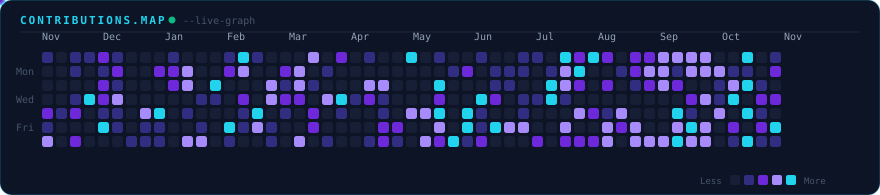

<!-- ===================== PROFILE HEADER ===================== -->

  

    

  <h1>
    Hey, I'm Kshitij Rastogi 👋
  </h1>

  

    <code>Full-Stack Engineer</code> &nbsp;•&nbsp; <code>AI &amp; Agentic Systems</code> &nbsp;•&nbsp; <code>Algorithmic Problem Solver</code>
  

  

    
    
    
    
  

  

    
  

  <blockquote align="center">
    <b><i>"Architecting intelligent full-stack systems and autonomous AI agents — turning complex algorithms into scalable, impactful digital reality."</i></b>
  </blockquote>

---

<!-- ===================== ABOUT ME ===================== -->

## 👨‍💻 About Me

I'm an **Information Technology engineer** at **Rajkiya Engineering College, Banda**, driven by a deep passion for full-stack engineering, distributed backend architectures, and cutting-edge artificial intelligence.

I specialize in crafting end-to-end web applications, deploying autonomous AI agents, and solving complex algorithmic challenges with clean, robust code.

- 🔭 **Focus Areas:** Full-stack architecture, Agentic AI systems, RAG pipelines, and high-concurrency backends.
- 🌱 **Actively Learning:** Advanced system design, LangGraph workflows, multi-agent orchestration, Docker, and Kubernetes.
- 🤖 **AI Specialization:** Autonomous AI Agents, LLM evaluation frameworks, prompt engineering, and multimodal systems.
- 💡 **Algorithmic Problem Solving:** **200+** DSA problems solved across LeetCode &amp; GeeksforGeeks.
- 🏆 **Hackathon Proven:** Finalist across multiple prestigious hackathons, including Top 33 out of 500+ teams nationwide with finals at **Microsoft's Gurugram HQ**.
- ⚡ **Passions:** Software crafting, distributed systems, technology, automotive engineering, and gaming.

---

<!-- ===================== TECH STACK ===================== -->

## 🛠️ Tech Stack &amp; Engineering Toolkit

#### ◈ Programming Languages

  

#### ◈ Frontend Engineering

  

#### ◈ Backend &amp; Distributed Architecture

  

#### ◈ Databases &amp; Cloud Storage

  

#### ◈ AI &amp; Agentic Frameworks

  
  
  
  
  
  

#### ◈ DevOps, Cloud &amp; Tools

  

---

<!-- ===================== FEATURED PROJECTS ===================== -->

## 🚀 Featured Engineering Projects

  

 

<table width="100%">
<tr>
<td width="50%" valign="top">

### 🩺 1. PulseTalk
An AI-powered healthcare assistant featuring conversational triage, real-time voice assistance, image-based disease prediction, and automated clinical appointment booking.

- **Stack:** `React` `TypeScript` `Express.js` `MongoDB` `Gemini API`
- 🌐 **Live Demo:** [pulsetalk.vercel.app](https://pulsetalk.vercel.app)
- 💻 **Source Code:** [rastkshitij/Pulsetalk](https://github.com/rastkshitij/Pulsetalk)

  
  

</td>
<td width="50%" valign="top">

### 🛡️ 2. OpsEcho
An intelligent AI incident commander platform featuring real-time audio rooms that extracts critical incident facts, active hypotheses, and prioritized action items from engineer discussions.

- **Stack:** `React` `TypeScript` `Node.js` `Socket.io` `Gemini API` `Agora RTC`
- 🌐 **Live Demo:** [opsecho-1-main.vercel.app](https://opsecho-1-main.vercel.app/)
- 💻 **Source Code:** [rastkshitij/OpsEcho](https://github.com/rastkshitij/OpsEcho)

  
  

</td>
</tr>
<tr>
<td width="50%" valign="top">

### ⚔️ 3. AI Battle Arena &amp; LLM Judge
A multi-agent AI framework comparing and benchmarking responses between frontier LLMs with an automated **LLM-as-a-Judge** scoring pipeline to quantify model quality and reasoning accuracy.

- **Stack:** `Python` `React` `LangChain` `AI Agents` `LLM APIs`
- 🌐 **Live Demo:** [ai-battle-arena-actual-ten.vercel.app](https://ai-battle-arena-actual-ten.vercel.app/)
- 💻 **Source Code:** [rastkshitij/aiBattleArenaActual](https://github.com/rastkshitij/aiBattleArenaActual)

  
  

</td>
<td width="50%" valign="top">

### 🔬 4. IIT Kanpur Virtual Lab
An interactive virtual simulation environment developed during a research internship at **IIT Kanpur**, empowering students with interactive visual physics and chemical state experiments.

- **Stack:** `JavaScript` `HTML5` `CSS3` `Interactive Physics Canvas`
- 💻 **Source Code:** [rastkshitij/diffrentstatesofwater-final](https://github.com/rastkshitij/diffrentstatesofwater-final)

  

</td>
</tr>
</table>

---

<!-- ===================== ACHIEVEMENTS ===================== -->

## 🏆 Honors &amp; Achievements

| Recognition | Event / Organization | Details |
| :--- | :--- | :--- |
| 🥇 **Hackathon Finalist** | **Ecosphere Hackathon** | Selected among the **top 33 teams out of 500+ teams** nationwide; final round held at **Microsoft's Gurugram Headquarters**. |
| 🏅 **HackFest Finalist** | **GDG Delhi HackFest** | Recognized among leading finalist engineering teams for innovative problem solving. |
| 🏅 **Top Finalist** | **GDG Noida HackFest** | Selected among top performing engineering teams for rapid prototype execution. |
| 💡 **DSA Problem Solver** | **Competitive Coding** | Solved **200+** Data Structures &amp; Algorithms challenges across platforms. |

---

<!-- ===================== GITHUB STATISTICS ===================== -->

## 📊 GitHub Analytics

  <table border="0" cellspacing="0" cellpadding="0">
    <tr valign="middle">
      <td align="center">
        
      </td>
      <td width="16">&nbsp;</td>
      <td align="center">
        
      </td>
    </tr>
  </table>

---

<!-- ===================== CONTRIBUTION GRAPH ===================== -->

## 🐍 Contribution Graph

  

---

<!-- ===================== LET'S CONNECT ===================== -->

## 🤝 Let's Connect &amp; Collaborate

  I'm always eager to connect with fellow engineers, collaborate on high-impact AI or full-stack products, and explore ambitious software opportunities.

  
  &nbsp;
  
  &nbsp;
  
  &nbsp;
  

    

  <h3>⚡ ❝ Think deeply. Build relentlessly. Ship fearlessly. ❞ ⚡</h3>
  
<i>Designing scalable architectures today &bull; Engineering the autonomous AI systems of tomorrow.</i>

